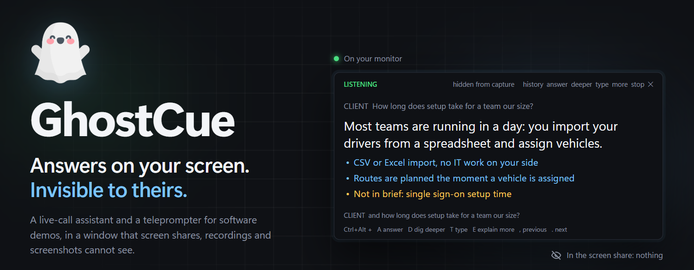

Two tools for showing software on a call, both in a window that you can see on
your monitor but that screen shares, recordings and screenshots cannot:

- **The assistant** listens to a live demo call and tells you what to say when
  the client asks a question.
- **The teleprompter** walks you through a timed script while you record a demo
  video.

Needs 64-bit Windows 10 version 2004 or later, and for the assistant
[Claude Code](https://claude.com/claude-code), installed and signed in.

## Install

Download `GhostCue-<version>-setup.exe` from the
[latest release](https://github.com/Blankscreen-exe/ghostcue/releases/latest) and
run it. It installs for your user only, without administrator rights, and adds
GhostCue and the teleprompter to the Start menu. To use it without installing,
download the `win64.zip` instead, unzip it anywhere and run `GhostCue.exe`.

GhostCue is not code-signed yet, so Windows SmartScreen says "Windows protected
your PC". Click **More info**, then **Run anyway**.

### From source

With Python 3.10 or later:

```
python -m venv .venv
.venv\Scripts\python -m pip install -r requirements.txt
```

Then double-click `GhostCue.bat`, or run `.venv\Scripts\python -m ghostcue`.

### Making a release

`packaging\build.ps1` builds `dist\GhostCue\` with PyInstaller, zips it, and, if
[Inno Setup 6](https://jrsoftware.org/isinfo.php) is installed, makes the
installer. It needs `packaging\requirements.txt` installed in `.venv` as well.
Set `GHOSTCUE_CONSOLE=1` to build an exe with a console, which shows errors and
can run `GhostCue.exe listen`.

Releases are made by GitHub Actions. To publish one, raise `__version__` in
`ghostcue/__init__.py` and push to `main`: when a push brings a version that has
no release yet, the workflow builds both files, tags the commit and publishes
them. Other pushes build nothing.

## The assistant

Start GhostCue from the Start menu (from source, double-click `GhostCue.bat`). It lives
in the system tray; click the icon for the settings window, right-click for the
menu.

1. **Context**: write the brief. What you are showing, who the client is, what
   they care about, what you must not promise.
2. **Knowledge**: add FAQs, pricing or specification files the answers should
   draw on.
3. **Audio**: play a sound and speak, and check that both level bars move.
4. Press **Start listening** before the call. The first start takes about ten
   seconds while Claude Code starts, and downloads the speech model once.

During the call the overlay shows the client's question, one sentence to say,
and up to three supporting points. **Answer length**, under Assistant, makes
every answer longer, up to a full explanation; Ctrl+Alt+E does it for one
question. A question about a set of things (types, steps, strategies) gets
every member whatever the length, and a request for code gets the code. An answer starts to appear about two to four
seconds after the client stops speaking. A point marked `Not in brief:` means
your material did not cover the question, and the sentence above it is a holding
answer rather than a fact.

| Ctrl+Alt + | Action |
|------------|--------|
| A | answer now, whatever the client last said |
| D | dig deeper: search the project folder set under Knowledge (several seconds slower) |
| T | type the client's question yourself, when it was misheard; Enter asks, Esc cancels |
| W | capture the window you are on and answer from it |
| E | explain more: answer the last question again, in full |
| S | show / hide the overlay |
| L | start / stop listening |
| , | show the previous answer |
| . | show the next answer |

Every answer of the call stays in the overlay until the next **Start listening**.
Ctrl+Alt+, and Ctrl+Alt+. step back and forward through them; `history`, in the
overlay's header, lists them all by the question they answered, and a click shows
one. While you are looking back, an answer that comes is not put in front of you:
the header says `NEW ANSWER`, and `latest` (or Ctrl+Alt+. to the end) shows it.

### Answering from a window

When the client asks about something on screen (a web page they sent, an email,
what they are showing you), click into that window and press Ctrl+Alt+W, or
`window` in the overlay's header. GhostCue captures the window, and the answer
uses what is on it. The line above the hotkeys says what was captured.

- **A web page in your browser** goes with its address and its whole text, read
  the way a screen reader reads it, so the parts above and below the screen come
  too, without scrolling. Very long pages are cut after 40,000 characters. The
  first capture in a browser can take a second while it prepares the text. This
  is tested with Chrome and Edge; other browsers built on Chromium (Brave, Opera,
  Vivaldi) should work the same, and a browser that gives no page text, perhaps
  Firefox, sends the screenshot alone.
- **Any other window**, the client's shared screen in Zoom or Teams among them,
  goes as a screenshot only: the answer knows what you can see, and no more.
- **Each capture stays in the call's conversation**, so later questions can use
  it without capturing again. The next Ctrl+Alt+D gets it too.
- The screenshot and page text are sent to Anthropic like the transcript, and
  only when you press the key. The transcript notes which window was captured,
  not what was on it.

`python -m ghostcue capture` captures the window in front after three seconds
and saves what Ctrl+Alt+W would send, to `%APPDATA%\GhostCue\capture.png` and
`capture.txt`, without sending anything.

### How it works

- **Client audio** is whatever your speakers or headphones play, captured with
  WASAPI loopback. **Your audio** is the microphone. Wear headphones; without
  them the microphone hears the client too, and GhostCue drops microphone speech
  that overlaps the client's.
- **Speech is transcribed on this computer** with faster-whisper. For English, `base`
  takes about 0.7 seconds a sentence on a six-core CPU; `small` is more
  accurate but takes 2 to 3 seconds without a GPU.
- **Answers come from your own Claude Code**, kept running for the length of the
  call so that each answer starts in under a second. The transcript, and any
  window you capture, is sent to Anthropic to be answered, as with any use of
  Claude Code, and counts towards
  your plan's usage. No Claude Code session is saved.
- **Settings and call transcripts** are kept in `%APPDATA%\GhostCue`. Turn
  transcripts off under Assistant.

### Urdu-speaking clients

Set **Call language**, at the top of the Context page or on the tray menu, to
Urdu or to Mix (Urdu + English). Mix checks each sentence for being plain
English first. Either switches the speech model to `small` and the answers to the client's
language, with Urdu written in Roman letters ("Hum ne Python isliye select
kiya…"). English sentences on the same call are still read as English.

Urdu recognition is much rougher than English: on a test recording about half
to four in five questions were understood, at 2.5 to 3.5 seconds a sentence. So
on these calls the overlay's first line, `ASKED`, shows the question as the
assistant understood it. Read it before you read the answer; if it is not what
the client asked, the answer is to the wrong question: press Ctrl+Alt+T and type
what they asked.

The `large-v3-turbo` speech model is far more accurate for Urdu but needs an
NVIDIA graphics card to be fast enough. It is used automatically when one is
present with its CUDA libraries installed; that path has not been tested.

### Before a real call

- Share your screen in a test meeting and confirm on a second device that the
  overlay is absent. Its header reads `hidden from capture` while the exclusion
  is active and a red `VISIBLE TO SCREEN SHARE` if it could not be applied.
- The overlay is hidden but your mouse pointer is not, so use the hotkeys.
- Speech recognition mishears names. List yours under Context, in "Names and
  jargon".
- Transcribing a call may require telling the people on it, depending on where
  they are.

From source, `python -m ghostcue listen` prints what is heard on each side, with
the delay, to check the audio without starting a call.

## The teleprompter

```
python -m ghostcue prompter my_script.txt --check   # print how the script was read, no window
python -m ghostcue prompter my_script.txt           # open the overlay
python -m ghostcue prompter                         # pick the script in a file dialog
```

It is also on the tray menu, and installed it is in the Start menu as GhostCue
Teleprompter, which asks for the script. The installed `GhostCue.exe prompter`
takes the same options, except `--check`, which prints and so needs the source
version. The teleprompter itself uses only the Python standard library.

| Option | Effect |
|--------|--------|
| `--to M:SS` | use only the cues that start before this time |
| `--from M:SS` | use only the cues from this time on, re-timed so it becomes 0:00 |
| `--manual` | change cues only with the hotkeys, not by the clock |
| `--font-size PT` | text size (default 15) |
| `--opacity 0-1` | window opacity (default 0.92) |
| `--geometry WxH+X+Y` | window size and position in pixels |

Scripts are plain text in one fixed format, specified in
[SCRIPT_FORMAT.md](SCRIPT_FORMAT.md); `example_script.txt` is a complete sample.

```
[0:12] Sign in
DO: Type the email and password, then click "Sign in".
SHOW: The dashboard, with the three summary cards.
SAY:
  I'll start by signing in with a demo account.
  This is the dashboard.
NOTE: If the login is slow, keep talking.
```

The left side shows the cue's directions (`SHOW` blue, `DO` amber, `NOTE` grey)
and the right side the words to say. Drag the window to move it and its
bottom-right corner to resize it. It never takes keyboard focus.

| Ctrl+Alt + | Action |
|------------|--------|
| Space | start / pause the clock |
| X / Z | next / previous cue |
| R | restart from the first cue |
| M | switch between auto and manual advance |
| Up / Down | bigger / smaller text |
| H | hide / show the overlay |
| Q | quit |

**Auto** (default): cues change at their timestamps, and Next/Previous move the
clock with them. **Manual**: cues change only when you press Next/Previous, and
the countdown turns red when you are behind the script's timing.
